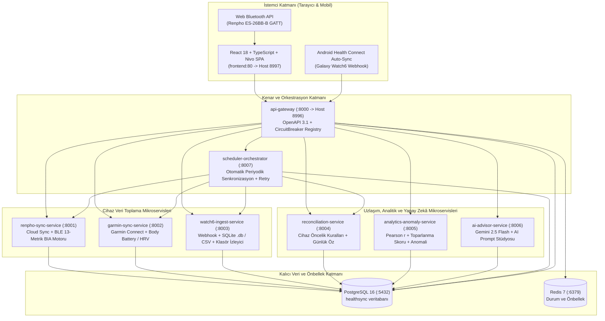

# HealthSync — Çoklu Cihaz Biyometrik Telemetri, Uzlaşım ve Anlamlandırma Mimarisi

## 1. Sistem Özeti ve Mimari Vizyon

**HealthSync**, üç farklı giyilebilir ve biyoelektrik empedans (BIA) cihazından gelen sağlık verilerini tam otomatik veya hibrit yöntemlerle toplayan, çakışan metrikleri akıllı öncelik kurallarıyla birleştiren ve klinik/fizyolojik anlamlandırma üreten yüksek dayanıklılığa (resilience) sahip mikroservis platformudur:

1. **Renpho Body Fat Scale ES-26BB-B**: Bulut API senkronizasyonu ve tarayıcı tabanlı **Web Bluetooth (`BLE`)** entegrasyonu ile 13 vücut kompozisyonu metriği (`weight_kg`, `bmi`, `body_fat_pct`, `subcutaneous_fat_pct`, `visceral_fat_index`, `body_water_pct`, `skeletal_muscle_pct`, `muscle_mass_kg`, `bone_mass_kg`, `protein_pct`, `bmr_kcal`, `metabolic_age`, `fat_free_weight_kg`).
2. **Samsung Galaxy Watch6**: Health Connect otomatik arka plan **Webhook** (`POST /api/ingest/webhook`), paylaşılan klasör izleyicisi (`WATCH_EXPORT_DIR`) ve manuel SQLite `.db` / `.csv` içe aktarımı.
3. **Garmin Smart Band**: Garmin Connect üzerinden otomatik periyodik senkronizasyon (adım, aktif kalori, dinlenik/min/maks nabız, uyku evreleri ve skoru, stres skoru, Body Battery, HRV ve SpO2).

---

## 2. Yüksek Dayanıklılıklı (High-Resilience) Mikroservis Topolojisi

Sistem, tek hata noktasını (Single Point of Failure) ortadan kaldırmak için **11 bağımsız Docker konteyneri** (8 Python FastAPI mikroservisi + PostgreSQL 16 + Redis 7 + Nginx/React Frontend) olarak tasarlanmıştır.

### Mikroservis Sorumluluk Tablosu

| Konteyner / Servis | İç Port | Dış Port | Temel Sorumluluk ve Hata İzolasyonu |
| :--- | :---: | :---: | :--- |
| `frontend` | `80` | `8997` | React 18, React Aria primitifleri, Nivo grafikleri, çift tema (`dark`/`light`) ve Nginx ters vekil sunucusu. |
| `api-gateway` | `8000` | `8996` | OpenAPI 3.1 sözleşme kapısı, tüm alt servisler için `CircuitBreaker` korumalı yönlendirme ve önbellekten zarif düşüş (graceful degradation). |
| `renpho-sync` | `8001` | — | Renpho ES-26BB-B bulut API senkronizasyonu, Web Bluetooth empedans/kilo paketlerinden 13 BIA metriğinin hesaplanması ve toplu silme. |
| `garmin-sync` | `8002` | — | Garmin Smart Band verilerinin (Body Battery, HRV, Stres, Uyku, Adım, Nabız) çekilmesi ve normalize edilmesi. |
| `watch6-ingest` | `8003` | — | Samsung Galaxy Watch6 Health Connect Webhook alımı, SQLite `.db` ve `.csv` ayrıştırma, `WATCH_EXPORT_DIR` otomatik klasör izleme. |
| `reconciliation` | `8004` | — | Watch6, Garmin ve Renpho verilerini metrik bazlı öncelik kurallarıyla (`priority`, `average`, `max`) tek bir **Günlük Öz** satırında birleştirme ve cihaz sapma analizi. |
| `analytics-anomaly` | `8005` | — | 7/30 günlük hareketli ortalamalar, Otonom Toparlanma Skoru (0–100), Kilo Değişim Kalitesi (yağ vs. kas vs. su), Pearson $r$ korelasyonları ve anomali tespiti. |
| `ai-advisor` | `8006` | — | Birleştirilmiş telemetri ve korelasyon çıktılarından Gemini AI anlamlandırma raporu ve harici LLM'ler için kopyalanabilir yapılandırılmış Prompt üretimi. |
| `scheduler` | `8007` | — | Periyodik senkronizasyon döngüsü, üstel geri çekilme (exponential backoff) ve cihaz bazlı senkronizasyon durum takibi. |
| `db` | `5432` | — | PostgreSQL 16 ilişkisel veritabanı (`WAL` ve sağlık kontrolü aktif). |
| `redis` | `6379` | — | Mikroservisler arası hızlı durum paylaşımı ve önbellekleme. |

---

## 3. Veritabanı Şeması (ER Diyagramı)

```mermaid
erDiagram
    SCALE_MEASUREMENTS {
        int id PK
        datetime measured_at
        string date
        string source
        float weight_kg
        float impedance_ohm
        float bmi
        float body_fat_pct
        float subcutaneous_fat_pct
        float visceral_fat_index
        float body_water_pct
        float skeletal_muscle_pct
        float muscle_mass_kg
        float bone_mass_kg
        float protein_pct
        float bmr_kcal
        int metabolic_age
        float fat_free_weight_kg
    }

    WEARABLE_DAILY_METRICS {
        int id PK
        string date
        string device_source
        int steps
        float active_calories_kcal
        float resting_hr_bpm
        float min_hr_bpm
        float max_hr_bpm
        float hrv_ms
        float sleep_hours
        float deep_sleep_hours
        float rem_sleep_hours
        float light_sleep_hours
        float sleep_score
        float stress_score
        float body_battery
        float spo2_pct
    }

    RECONCILED_DAILY_SUMMARIES {
        int id PK
        string date UK
        float weight_kg
        float body_fat_pct
        float skeletal_muscle_pct
        float body_water_pct
        int steps
        float active_calories_kcal
        float sleep_hours
        float sleep_score
        float resting_hr_bpm
        float hrv_ms
        float stress_score
        float body_battery
        float spo2_pct
        float recovery_score
        string winning_sources_json
    }

    RECONCILIATION_CONFIGS {
        int id PK
        string weight_priority
        string sleep_priority
        string activity_priority
        string heart_priority
        string merge_strategy
        string cycle_start_date
        float target_weight_kg
        float height_cm
    }

    SYNC_RUNS {
        int id PK
        string provider
        string mode
        string status
        int records_synced
        float duration_ms
        string message
        datetime started_at
        datetime finished_at
    }

    AI_REPORTS {
        int id PK
        datetime created_at
        string model_used
        string focus_area
        string summary
        string recommendations_json
        string raw_markdown
    }

    INTEGRATION_SETTINGS {
        int id PK
        string renpho_email
        string renpho_password
        string garmin_email
        string garmin_password
        string gemini_api_key
        string webhook_secret
        string watch_export_dir
        int auto_sync_interval_minutes
        int webhook_expected_interval_minutes
        datetime updated_at
    }

    WEBHOOK_HEARTBEATS {
        int id PK
        string source
        string device_label
        string event_type
        string status
        int records_received
        float latency_ms
        string payload_summary
        datetime created_at
    }
```

---

## 4. Dayanıklılık (Resilience), Devre Kesici ve Gözlemlenebilirlik

- **Devre Kesici (`CircuitBreaker`)**: `services/common/resilience.py` içerisindeki devre kesici her alt mikroservis için hata sayısını izler. Ardışık 3 hatada devre `OPEN` durumuna geçer ve 15 saniye boyunca alt servisi yormadan yerel veritabanı/önbellek yedeğinden (`fallback`) yanıt döner. Süre sonunda `HALF_OPEN` durumuna geçerek servisi test eder ve başarılı olduğunda `CLOSED` durumuna döner.
- **Yapılandırılmış Tek Satır JSON Loglama**: Tüm mikroservisler `services/common/logger.py` üzerinden `stdout` akışına `{"timestamp", "level", "service", "event", "correlation_id"}` formatında tek satır JSON yazar.
- **RFC 7807 Problem Details**: Tüm hata yanıtları `{"type", "title", "status", "detail", "instance", "correlation_id"}` zarfıyla döner.
- **Bölüm 6 Dönemsel Pencere Koruması (Temporal Window Guard)**: Kullanıcı yeni bir beslenme/antrenman döngüsü başlattığında (`cycle_start_date`), önceki döneme ait veriler mevcut döngünün başlangıç/bitiş veya delta hesaplamalarına sızmaz; yeni döngüde henüz ölçüm yoksa sistem uydurma sayı üretmek yerine açıkça `window_status: "pending"` (`Bekleniyor`) durumu döner.
